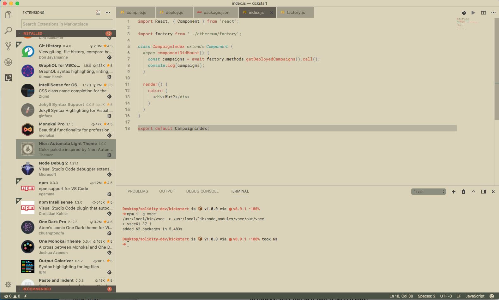

# Introduction

Personal VSCode theme inspired by [Nier: Automata the game](https://www.niergame.com/agegate.php). Generated by [Themer](https://themer.mjswensen.com/) and some retouch from me.

Only available in Light theme though :)

# Installation
## VSCode
Install from the Extension Marketplace.

Alternatively:

1. Clone this repo into the extensions folder:
```bash
git clone https://github.com/shelune/vscode-nier-automata-light.git ~/.vscode/extensions/vscode-nier-automata-light
```

2. Run "Extensions: Install from VSIX..." from the VSCode Command Palette (Ctrl+Shift+P) to install the desired `.vsix` from the cloned repo.

## VSCodium
1. Clone this repo into the extensions folder:
```bash
git clone https://github.com/shelune/vscode-nier-automata-light.git ~/.vscode-oss/extensions/vscode-nier-automata-light
```
2. Run "Extensions: Install from VSIX..." from the VSCodium Command Palette (Ctrl+Shift+P) to install the desired `.vsix` from the cloned repo.

    Caution: 
    - Attempting to install the v1.0.1 `.vsix` (prior to installing the v1.0.0 `.vsix`) will result in the removal of the cloned git repo and a VSCodium error ("Extract: ENOENT: no such file or directory, open '~/.vscode-oss/extensions/vscode-nier-automata-light/vscode-nier-automata-theme-1.0.1.vsix").
    - Avoid this issue by installing the v1.0.0 `.vsix` prior installing the v1.0.1 `.vsix`.

# Demo

